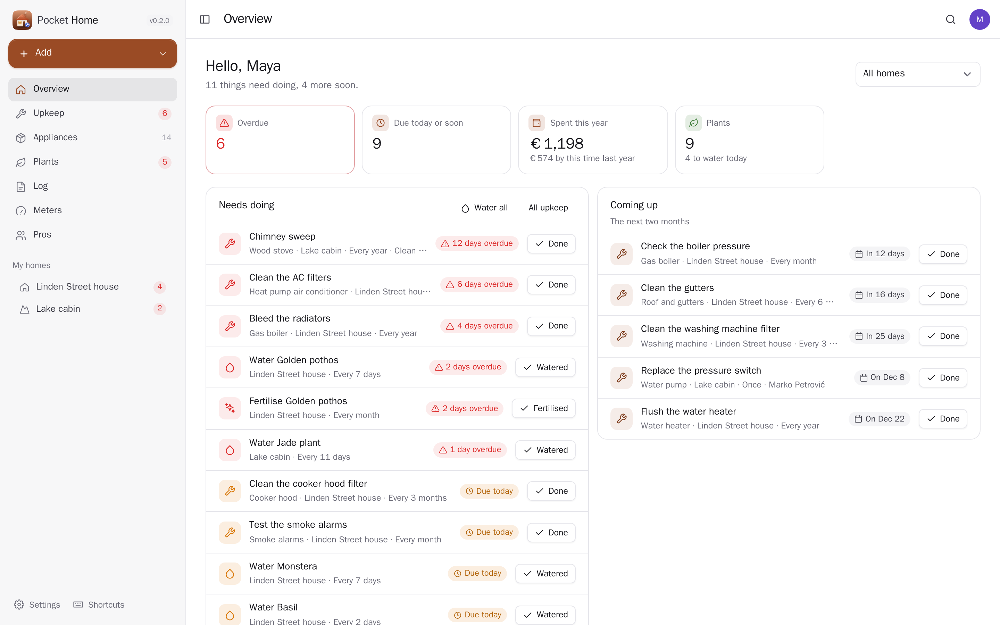
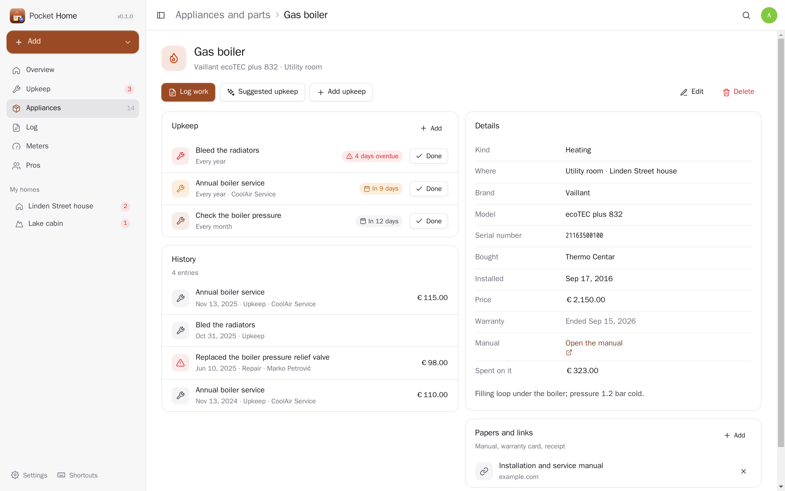
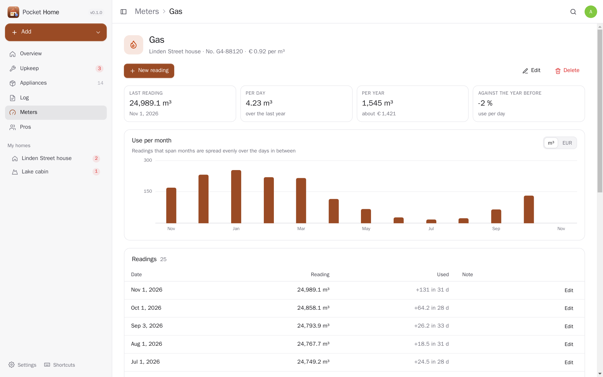
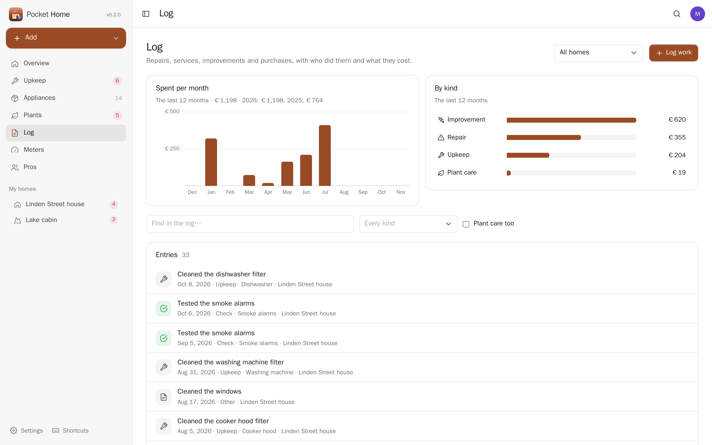
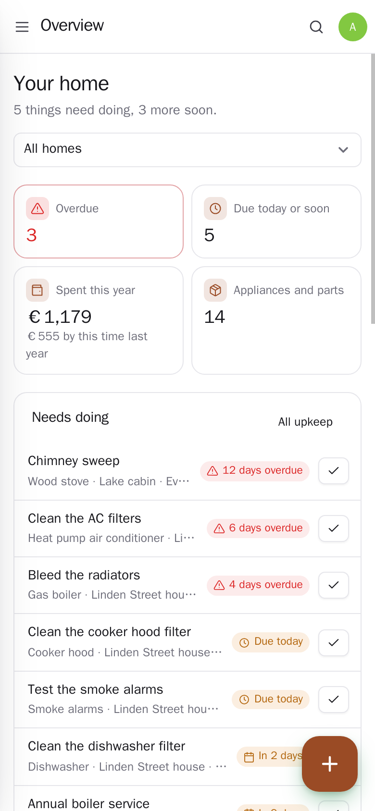

<p align="center"></p>
<h1 align="center">Pocket Home</h1>
<p align="center">Look after your home on your own server: the boiler, the roof, the washing machine and everything else that needs a service now and then, with their model, warranty, manual and history. Upkeep that comes back (a boiler service every year, AC filters every three months, smoke alarms every month) reminds you before it is due, and marking it done writes the log and sets the next date. The log keeps every repair, improvement and purchase with who did it and what it cost; meter readings turn into use per month. Costs book themselves in Pocket Money, due dates show up in Pocket Calendar, manuals and invoices come from Pocket Documents, and Pocket AI can tell you what is due this week.<br>One Go binary, one SQLite file, one volume. Part of the Pocket apps; works on its own too.</p>
<p align="center">
  <a href="https://github.com/abjelosevic88/pocket-homelab-home/actions"></a>
  <a href="https://github.com/abjelosevic88/pocket-homelab-home/pkgs/container/pocket-homelab-home"></a>
  <a href="LICENSE"></a>
</p>

---

<p align="center"></p>

<table>
  <tr>
    <td width="50%"></td>
    <td width="50%"></td>
  </tr>
  <tr>
    <td align="center"><sub>Every appliance with its upkeep, history, warranty, manual and the invoice from Pocket Documents.</sub></td>
    <td align="center"><sub>Meter readings become use per month, in units or money, against the year before.</sub></td>
  </tr>
  <tr>
    <td width="50%"></td>
    <td width="50%"></td>
  </tr>
  <tr>
    <td align="center"><sub>The log: what the house cost per month and by kind; each cost can be a Pocket Money transaction.</sub></td>
    <td align="center"><sub>Made for the phone too: the + button logs work, adds upkeep or a meter reading.</sub></td>
  </tr>
</table>

## What it does

- **Appliances and parts of the house**: brand, model, serial number, where it is, when it was bought and installed, the price, the warranty (a reminder 30 days before it ends) and the manual — a link, or the PDF kept in Pocket Documents.
- **Upkeep that comes back**: every N days, weeks, months or years, or once. Due soon, due today, overdue; mark it done (with the cost and who did it) and the next date is counted from the day you did it. Skip a time, or move it a few days.
- **Suggested upkeep**: pick an appliance and get the usual jobs for it — a boiler service, bleeding radiators, the dishwasher filter, the anode rod — or ask Pocket AI for its exact model.
- **The log**: repairs, services, improvements, checks and purchases; spending per month, by kind and per appliance.
- **Meters**: electricity, water, gas, heating, solar, oil. Readings turn into use per month (spread over the days between readings), a cost per year with your price per unit, and a comparison with the year before. A monthly reminder to read them.
- **Pros**: the plumber, the electrician, the chimney sweep, with their work and what it cost; pick them from Pocket Contacts.
- **More than one home**: a house, a flat, a weekend cottage — each with its own currency, notes (where the water and gas shut-offs are) and papers.
- **One message a day** when something becomes due, a warranty ends or a meter needs reading (Apprise, ntfy or a JSON webhook).
- **Everyone their own**: each person has their own homes, settings and connections; admins see no one else's.
- **Export and import** as JSON (idempotent), the log as CSV, a whole-database backup for admins.

## Run it

```sh
docker run -d --name pocket-home -p 8080:8080 -v ./data:/data \
  -e BASE_URL=https://home.example.com -e SECURE_COOKIES=true \
  ghcr.io/abjelosevic88/pocket-homelab-home:latest
```

or `docker compose up -d` with [docker-compose.yml](docker-compose.yml). Open it, create the first account and add your home. All options: [docs/configuration.md](docs/configuration.md). API: [docs/api.md](docs/api.md).

## With Pocket Core

Set `CORE_URL` and `CORE_REGISTRATION_KEY` and Home joins the box: people sign in with Pocket Core, and through app links each person's home reaches their own Pocket apps with nothing to paste:

| App | What Home does there | Scopes |
|---|---|---|
| Pocket Money | a cost in the log becomes a transaction on your account; edits follow, delete removes it | `accounts:read`, `transactions:write` |
| Pocket Calendar | upkeep due dates as all-day events, moved when the date changes | `calendar:read`, `calendar:write` |
| Pocket Tasks | “Add to my tasks” on a job, with its due date and a link back | `tasks:write` |
| Pocket Contacts | pick a pro from your address book | `contacts:read` |
| Pocket Documents | keep a manual, warranty card or invoice with an appliance, a repair or a home | `documents:read` |
| Pocket Inventory | link an appliance to its item on your shelves | `items:read` |
| Pocket AI | upkeep suggestions for an exact model; the Ask button on every page | inference |

Other apps can read your home (`home:read`: Pocket AI's “what is due this week?”, Pocket Day's journal) or log work for you (`home:write`: a repair booked elsewhere, a smart meter's reading). Events on the bus: `home.job_done`, `home.job_due`, `home.record_added`, `home.reading_added`, `home.thing_saved`, `home.warranty_ending`. Without Core every connection can be made directly with a URL and a token; the Core-only choices stay visible, greyed out.

## Develop

```sh
make dev     # API on :8080 with demo data + Vite on :5173
make test    # go vet, go test, tsc
make         # web + binary
```

MIT licensed. Upkeep suggestions are general guidance; the manual of your model comes first, and gas, electrics and roofs are work for a qualified person.
